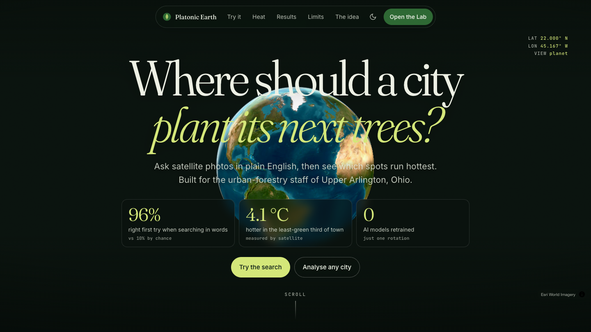
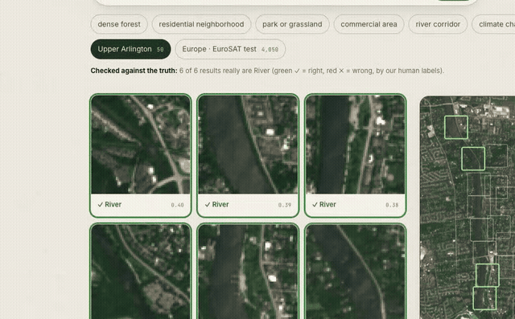
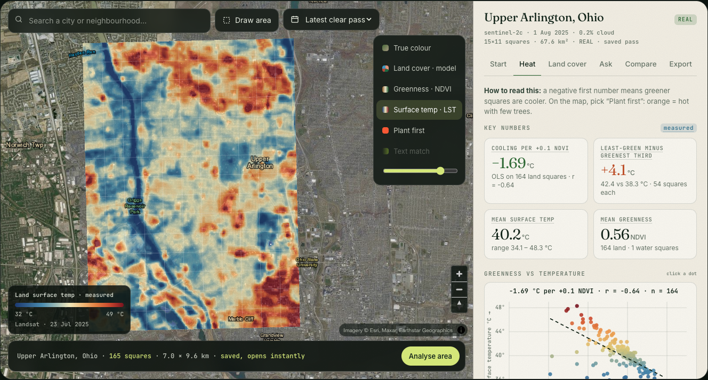

<div align="center">

# 🌳 Platonic Earth

### Where should a city plant its next trees?

**Search satellite photos in plain English, then see which spots run hottest.**<br>
Built for the urban-forestry staff of Upper Arlington, Ohio.

**[▶ Try it in your browser](https://johnpoole3rd.github.io/veritas/)** · **[🎬 2-minute video](#video)** · **[📄 Write-up](WRITEUP.md)** · **[Run it yourself](#run-it-yourself)**

Veritas AI International High School Hackathon 2026 · **AI + Climate** track



</div>

> **Prototype, not a land-use determination.** Do not use it for permitting, taxation or legal decisions. Land cover is a model estimate; greenness and surface temperature are satellite measurements.

## The takeaway

<!-- auto:takeaway -->
**One rotation joins two AI models that were never trained together.** Plain-English search finds the right land type first in **96%** of 50 searches over 4,050 unseen satellite photos (random rotation 15.2%, no rotation 10%). A fully trained ResNet-18 labels photos better (98.2% vs our 81.2%) but cannot take a question in words. In Upper Arlington it is a **tie** (64% vs 62% for always answering “Residential”), and the heat data says where trees matter: **−1.69 °C per +0.1 greenness**, least-green third **4.1 °C** hotter.
<!-- /auto:takeaway -->

## What it does

| You give it | You get back |
|---|---|
| Words, e.g. `river corridor`, `parking lot`, `tall trees near a river` | The best-matching 640 m satellite squares, each with a similarity score (not a probability) |
| An area on the map (Upper Arlington and Phoenix are saved) | A heat map, the cooling per +0.1 greenness, a **“plant first”** list of hot, bare squares, and CSV / GeoJSON exports |

 

## How it works

```text
satellite photo ──► DINOv2 (picture AI, frozen) ──► 384 numbers ─┐
                                                                 ├─► one rotation (orthogonal Procrustes) ─► compare ─► best matches
"river corridor" ─► MiniLM (word AI, frozen) ────► 384 numbers ──┘      fit once on labelled EuroSAT photos
```

1. **Two AI models that never met.** DINOv2 turns a picture into a list of numbers. MiniLM turns a sentence into a list of numbers. Neither is retrained.
2. **One rotation lines them up.** Orthogonal Procrustes finds the single rotation that best matches photo-numbers to caption-numbers on labelled EuroSAT photos. It can turn the space but never stretch it. It's a closed-form step with no training loop, and it tests the *Platonic Representation Hypothesis* (Huh et al., 2024): do separately trained models share one picture of the world?
3. **Heat is measured, not guessed.** The Heat Lab pairs a clear Sentinel-2 pass (greenness, NDVI) with the nearest Landsat pass (ground surface temperature), then ranks hot squares with few plants.

## Results

All numbers below come from logged files in [`artifacts/metrics/`](artifacts/metrics/); the tests use held-out data that was never used for fitting.

<!-- auto:results -->
**1 · Search in words** (text → photos; 50 caption queries, each over all 4,050 held-out EuroSAT test photos; top-1 = the first photo has the right land type)

| Method | Top-1 | Top-5 | Verdict |
|---|---:|---:|---|
| **Procrustes rotation (ours)** | **96%** | **100%** | ahead |
| Random rotation (control, mean of 5 seeds) | 15.2% | 28% | |
| No rotation (control) | 10% | 34% | |

**2 · Label each photo** (image → one of 10 land types; N = 4,050 held-out EuroSAT test photos)

| Method | Accuracy | Macro-F1 | Verdict |
|---|---:|---:|---|
| ResNet-18, fine-tuned on the labels (strong baseline) | 98.2% | 98.1% | |
| **Procrustes rotation (ours, no training)** | **81.2%** | 79.5% | **behind ResNet**, far ahead of the controls |
| Random rotation (control) | 15.5% | 13.9% | |
| Always the most common class (“AnnualCrop”) | 11.1% | 2.0% | |

**3 · Our own town** (N = 50 Sentinel-2 tiles of Upper Arlington, Ohio, labelled by the team)

| Method | All tiles | Clear-cut tiles | Verdict |
|---|---:|---:|---|
| **Procrustes rotation (ours)** | **64%** | 81.1% | **tie** |
| ResNet-18 | 64% | 81.1% | |
| Always “Residential” (uses the local answers) | 62% | 78.4% | |

**4 · Heat, measured** (Upper Arlington; Sentinel-2 greenness vs Landsat ground temperature; 164 land squares of 640 m)

- Cooling: **−1.69 °C per +0.1 NDVI** (straight-line fit, r = −0.64).
- Least-green third vs greenest third: **42.4 °C vs 38.3 °C** (54 squares each). Phoenix, Arizona: −1.13 °C per +0.1 NDVI (r = −0.61).

**Where it fails:** rivers. 0 of 10 Upper Arlington river tiles get the right label; at 10 m per pixel a thin river looks like a road (River → Highway is also the top EuroSAT mix-up: 122 river photos, 32%).
<!-- /auto:results -->

**Honest reading.** Search in words works well on the European test set, and one rotation is far better than a random rotation. A model trained on the labels (ResNet-18) still labels photos better, but it cannot answer a new question in words. On our own town, both models only tie with always answering “Residential”. That is a case study, not a benchmark. Similarity scores also don't tell right answers from wrong ones, so the tool can't yet say “I don't know”.

## Video

🎬 **2-minute demo:** [`assets/PlatonicEarth_demo.mov`](assets/PlatonicEarth_demo.mov) (open it on GitHub to play, or download it). It has burned-in captions, so it works muted. Captions file: [`video/captions.srt`](video/captions.srt).

## Try it

- **In your browser, nothing to install:** **https://johnpoole3rd.github.io/veritas/**. This public copy has the saved study areas (Upper Arlington and Phoenix). Typed searches run the same MiniLM model *in your browser*, so any words work. The first search downloads the model once. Analysing a new city needs the Python server below.

## Run it yourself

Needs Python 3.11+ and a few GB of disk for the models and data.

```sh
git clone https://github.com/JohnPoole3rd/veritas && cd veritas
python -m venv .venv && source .venv/bin/activate
pip install -r requirements.txt
python app.py --prefetch                 # once, online: caches MiniLM + DINOv2
python -m web.server --port 8000         # open http://localhost:8000/
```

- The full site, including **any city**: draw a box anywhere (up to 400 squares). It fetches live Sentinel-2 and Landsat passes, so it needs internet.
- The original Gradio demo is at `/classic/`.
- To reproduce the numbers from scratch, run J's pipeline (`scripts/run_j_pipeline.sh`) and A's baselines (`scripts/evaluate_majority.py`, `scripts/train_resnet.py`, `scripts/evaluate_local.py`). Exact steps are in [`plan/agents/`](plan/agents/).
- Tests: `python -m pytest -q tests`

**Rebuild the public copy and the docs** after any metrics change:

```sh
python -m web.bake_story        # story data + images
python -m web.build_static      # docs/ (GitHub Pages copy), from the real server, in REAL mode
python scripts/sync_docs.py     # README + WRITEUP number blocks
```

## Repo map

| Path | What |
|---|---|
| `src/` | Data, captions, encoders, Procrustes alignment, retrieval, baselines, evaluation |
| `scripts/` | Runnable pipeline: data → embeddings → rotation → evaluation; `sync_docs.py` |
| `artifacts/metrics/` | Every logged result (CSV / JSON) |
| `artifacts/figures/` | Failure gallery, confusion matrices |
| `data/local_tiles/` | The 50 Upper Arlington tiles and their labels |
| `web/` | Website: FastAPI server (`server.py`), satellite fetching (`geo.py`), analysis, static front end, `build_static.py` |
| `docs/` | Generated public copy for GitHub Pages (do not edit by hand) |
| `video/` | The demo video: Remotion project, screen-recording script, captions |
| `app.py` | Original Gradio demo |
| `results/` | Per-task reports (T01–T14) |
| `plan/` | Plan, decisions, team rules, learnings |
| `tests/` | Unit tests |

## Team and credits

**Team:** J (integration, data and alignment), A (baselines and local validation), D (website, video and docs).

**Data**
- **EuroSAT** (Helber et al., 2019): https://github.com/phelber/EuroSAT
- **Copernicus Sentinel-2** L2A (ESA), via Earth Search STAC: https://earth-search.aws.element84.com/v1
- **Landsat 8/9** Collection 2 Level-2 surface temperature (USGS/NASA)
- **OpenStreetMap** contributors (ODbL), for place search and the city boundary; **ESA WorldCover 2021** (CC-BY 4.0)
- Basemap: **Esri World Imagery**

**Models**
- **DINOv2** (Oquab et al., 2024; `facebook/dinov2-small`, Apache-2.0)
- **all-MiniLM-L6-v2** (sentence-transformers, Apache-2.0)
- **ResNet-18** (He et al., 2016), ImageNet weights via torchvision

**Idea:** the Platonic Representation Hypothesis (Huh, Cheung, Wang & Isola, ICML 2024): https://arxiv.org/abs/2405.07987

**Software:** PyTorch, torchvision, Hugging Face Transformers, Sentence-Transformers, scikit-learn, SciPy, NumPy, pandas, FastAPI, Gradio, MapLibre GL, transformers.js, Playwright, Remotion.

**AI tools:** Claude (Anthropic), through Claude Code, helped write code, the website, the video and the documentation. The team chose the project, collected and labelled the local tiles, and checked every result.

**What we added** to the suggested starting project (land-use mapping with EuroSAT and ResNet-18, now our baseline):
- **our own user and place:** Upper Arlington urban forestry;
- **our own data:** 50 local tiles we labelled, plus live Landsat heat;
- **our own question:** can one rotation join image and text models?

**License:** GPL-3.0 (see `LICENSE`).
